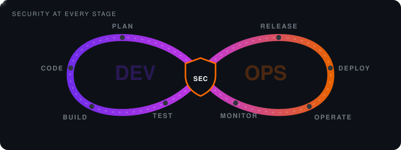
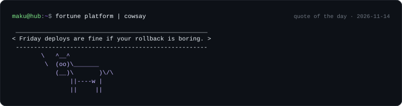
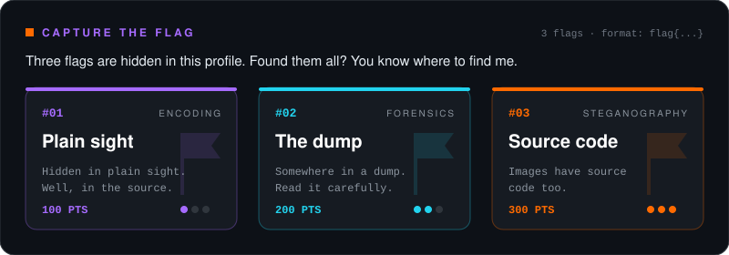

```mermaid
flowchart LR
    commit([git push]) --> lint[Lint &amp; format]
    lint --> secrets{{Secret scan}}
    secrets --> sast{{SAST}}
    sast --> tests[Unit &amp; integration tests]
    tests --> build[Build image]
    build --> sca{{SCA &amp; image scan}}
    sca --> sbom[SBOM]
    sbom --> sign[Sign artifact]
    sign --> deploy[Deploy]
    deploy --> dast{{DAST}}
    dast --> monitor[(Monitor &amp; alert)]
    monitor -. feedback .-> commit

    classDef sec fill:#ff6a00,stroke:#ff6a00,color:#fff
    classDef step fill:#1e1b2e,stroke:#a66bff,color:#fff
    class secrets,sast,sca,dast sec
    class lint,tests,build,sbom,sign,deploy,monitor step
```

<p align="center">
  
</p>

<p align="center">
  <picture>
    
  </picture>
</p>

<p align="center">
  
  <br />
  <a href="https://github.com/Maku-hub?tab=followers"></a>
  <a href="https://github.com/Maku-hub?tab=repositories"></a>
  <a href="https://maku-hub.github.io/whoami"></a>
  
  <a href="https://github.com/Maku-hub/Maku-hub/actions/workflows/profile.yml"></a>
</p>


### 💻 whoami

<p align="center">
  
</p>


### 🌳 Public projects over time

<p align="center">
  
</p>


### 🕒 Recent commits

<p align="center">
  
</p>


### 🧬 Code DNA

<p align="center">
  
</p>


### ♾️ How I work

<p align="center">
  
</p>

<div align="center">
<details>
<summary><i>Security isn't a stage. It's the thing every stage passes through.</i></summary>
<br>



</details>
</div>

$$
\text{reliability} = \frac{\text{automation} \times \text{monitoring}}{\text{manual steps} + \varepsilon}
$$


### 🐄 Quote of the day

<p align="center">
  
</p>


### 🚩 Capture the flag

<p align="center">
  
</p>

<!-- flag 1/3: ZmxhZ3t5MHVfZjB1bmRfbTRrdX0= -->

<details>
<summary><code>$ xxd /dev/maku</code> — memory dump</summary>
<br>

```console
00000000: 4d41 4b55 2d48 5542 202f 2f20 504c 4154  MAKU-HUB // PLAT
00000010: 464f 524d 2045 4e47 0a73 796e 747b 7533  FORM ENG.synt{u3
00000020: 6b5f 7a34 6578 665f 6775 335f 6663 3067  k_z4exf_gu3_fc0g
00000030: 7d0a 2d2d 206e 6f74 2065 6e63 7279 7074  }.-- not encrypt
00000040: 696f 6e20 2d2d 0a                        ion --.
```

</details>

<details>
<summary><code>$ ./cheats</code> — <kbd>↑</kbd> <kbd>↑</kbd> <kbd>↓</kbd> <kbd>↓</kbd> <kbd>←</kbd> <kbd>→</kbd> <kbd>←</kbd> <kbd>→</kbd> <kbd>B</kbd> <kbd>A</kbd></summary>
<br>

> [!TIP]
> **+30 lives.** Hints unlocked:
> 1. Base64 is an encoding, not a secret.
> 2. ROT13 is a substitution, not a cipher you should trust.
> 3. Open [`assets/hero.svg`](assets/hero.svg) and switch to Code view.

</details>

<details>
<summary><code>$ cat /.well-known/security.txt</code> — responsible disclosure</summary>
<br>

```text
# Found something? Responsible disclosure welcome.
Contact: https://maku-hub.github.io/whoami
Preferred-Languages: pl, en
Policy: be kind, be specific, include a PoC
Acknowledgments: you, in this file, if you find all three flags
Expires: never — this README maintains itself
```

</details>

<br>


